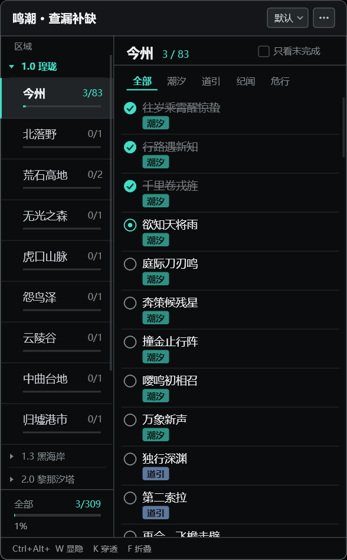

# ww-tasker · 鸣潮任务查漏补缺

一个贴在《鸣潮》画面上的小清单。左边是版本列表，右边一条一条打勾，**不读内存、不注入、不截屏**——就是一张你自己点的表。



折叠起来就剩下一条：


这两张图都是程序自己离屏渲染的，以 2 倍分辨率存着，缩到 1 倍看才不糊。

## 它是干什么的

清地图最烦的不是打怪，是「这版更新里我到底还差哪个任务」。这软件就是干这个的：把每个版本要做的任务列成一张表，你做到哪就勾到哪，剩下的自然浮出来。

- **只要任务**。潮汐、伴星、道引、纪闻、危行、隐藏、活动，宝箱声匣成就一概不管。数据来自 B 站合集，23 个版本共 335 条。
- **左右两列，各管各的**。左列按版本平铺（1.0 一直排到 3.8，滚着看，做完的版本可以藏起来）；右列按类型分页签，只看潮汐或者只看隐藏都行，签位只列这个版本真有的类型。
- **能搜任务名**。头部那个「搜索任务名」点一下输几个字，跨全部版本一起找，结果里带版本号。搜的时候分页签自动让位。
- **三态**：未开始 / 进行中 / 已完成。点圆圈就换一档，不用开下拉框。
- **隐藏任务单独标出来**。那种没有追踪、得靠走近才触发的，用灰色 ▸ 标记，免得你满地图乱转找一个根本不会出现在任务列表里的东西。
- **每条能写备注**。右键写一行，比如「前置没做完」。
- **滚到哪儿记着哪儿**。换版本、换分页签、关掉再开，都回原位。

## 怎么用

双击 `WuwaChecklist.exe`。就这一个文件，没有安装程序，不需要装 .NET。

| 按键 | 干什么 |
| --- | --- |
| `Ctrl+Alt+W` | 显示 / 隐藏 |
| `Ctrl+Alt+K` | 锁定（点击穿透，鼠标穿过面板点游戏）|
| `Ctrl+Alt+F` | 折叠成一条细条 |

三个键都能在 `⋯` → `快捷键…` 里改。

窗口左下角能拖边改大小，右下角也行——它是无边框的，那圈 6 像素的边是自己算出来的。

- **托盘图标**：关掉面板不代表退出，右下角托盘里那个白毛兽耳娘点一下就回来。不想要就 `⋯` → `任务栏显示图标` 关掉。
- **字号**：`⋯` → `字号 90% / 100% / 115%`，整块等比放大，行高和内边距跟着一起走，不是只把字撑大。
- **导出**：`⋯` → `导出任务库…`，把当前这份任务表存成 JSON。

穿透那个特别好用：勾完就锁上，面板还挂在那儿，但鼠标可以直接点底下的游戏，不会误触。

## 关于「游戏里看不见」

**独占全屏模式下，Windows 上任何悬浮窗都画不出来**，这不是这个程序的问题，是系统的物理限制（全屏那一层独占显示输出）。想要它盖在游戏上，把游戏设成**无边框窗口 / 窗口化全屏**。

程序检测到前台是全屏应用时会在面板底下挂一行提示：`独占全屏时看不见我，Ctrl+Alt+W 试一下`。

## 任务库

任务列表放在 [`data/quests.json`](data/quests.json)，跟程序分开。改数据不用重新编译。

程序内 `⋯` → `检查任务库更新…` 会从仓库拉最新的那份，**跟你本地这份合并**（同组同名合成一条，你手工加的任务不会被冲掉），拉失败就继续用本地/内置的，不会把程序搞坏。网络请求有 8 秒超时，拉不动就报一句人话，不会把面板卡住。

格式长这样（现在这份是从 B 站合集导出来的，共 23 个版本 / 335 条）：

```json
{
  "schemaVersion": 3,
  "gameVersion": "3.8",
  "regions": [
    {
      "id": "v10",
      "name": "1.0",
      "chapter": "",
      "order": 10,
      "quests": [
        { "id": "jz-10-003", "name": "嘤鸣初相召", "type": "main", "url": "https://www.bilibili.com/video/BV...?p=7" },
        { "id": "v10-041", "name": "水帘洞天", "type": "hidden", "hidden": true }
      ]
    }
  ]
}
```

> 分组的 `id`/`name` 现在装的是**版本号**（`v10` = 1.0），地图信息降到每条任务的 `subArea` 里。
> `chapter` 留空表示这一列平铺不折叠——想改回按大地图分组，把 `chapter` 填上、`name` 换成地图名就行，界面会自动折。

| 字段 | 说明 |
| --- | --- |
| `type` | `main` 潮汐 / `tale` 道引 / `comp` 伴星 / `side` 纪闻 / `expl` 危行 / `hidden` 隐藏 / `event` 活动 |
| `hidden` | `true` 表示无追踪、要触发的隐藏任务 |
| `subArea` | 子地图名，显示在任务名下面 |
| `url` | 对应 B 站分 P 的链接，任务右键菜单里能直接打开 |
| `note` | 写死在库里的说明（你自己写的备注在存档里，不在这） |

> ⚠️ **`id` 定下来就不要改了。** 存档只记 id 不记任务名，改 id 等于那条记录丢了。改名字、改错字、改子地图都不影响进度。

### 同名任务会合并

同一个分组（现在就是同一个版本）里名字一样的任务（忽略空格、不分大小写）会被合成一条，不会因为你从两份清单里抄重了就出现两行。

合并的时候：

- **任一份标了 `hidden` 就算隐藏** —— 宁可多提醒一句，也不要让一条没追踪的任务被当成普通任务漏掉。
- 空字段才补。子地图、链接缺了才拿另一份的填。
- 两份备注不一样就拼起来，用 `；` 隔开。
- 类型冲突取更具体的那档（潮汐 > 伴星 > 道引 > 纪闻 > 危行 > 隐藏）。

被合进来的旧 id 记在 `mergedIds` 里，**你挂在旧 id 上的进度会自动挪到合并后的任务上**（两边都有进度时取更靠后的那档，备注拼起来）。

跨分组同名的**不合并**——1.0 和 3.5 各有一条「走失的机械犬」就是两条，各勾各的。

## 存档

存在 `%APPDATA%\ww-tasker\profile.json`，支持多个存档（`⋯` → 存档名 → 新建/改名/删除）。

覆盖安装、换新版 exe 都不影响，因为这个文件在 AppData 里，不在程序目录。

## 自己编译

需要 .NET SDK（8 或更高）。目标框架是 .NET Framework 4.8，产出一个单文件 exe，Windows 10/11 自带运行时，别人拿去双击就能跑。

```powershell
dotnet build src/WuwaChecklist.csproj -c Release
# 产物：src/bin/Release/WuwaChecklist.exe
```

界面全用 C# 手写（没有 XAML），配色和尺寸在 `src/Theme.cs`，绘制在 `src/PanelView.cs`。

图标是 `tools/make_icon.py` 从 `assets/logo.png` 生成的 `src/app.ico`（7 帧：16/24/32/48/64/128/256）。换图就换掉 `assets/logo.png` 再跑一次：

```powershell
python tools/make_icon.py
dotnet build src/WuwaChecklist.csproj -c Release
```

README 里那两张图是程序自己离屏渲染的，不是截屏——面板半透明，截屏会把桌面一起拍进去：

```powershell
# 主界面（392×440，底下垫一层代码画的假游戏底色）
.\src\bin\Release\WuwaChecklist.exe --shot docs\shot-main.png 392 440
# 折叠细条
.\src\bin\Release\WuwaChecklist.exe --shot docs\shot-stripe.png --folded
```

加 `--plain` 就渲染成透明底 PNG，方便自己拿去别处用；`--scale 1.15` 按 115% 字号出图（画布宽高要一起放大，否则会被裁）。

## 发版

打 tag 就自动打包：

```bash
git tag v0.1.0
git push origin v0.1.0
```

`.github/workflows/release.yml` 会编译、打 zip、用 [git-cliff](https://github.com/orhun/git-cliff) 按 `cliff.toml` 生成更新日志，然后发到 Releases。

压缩包名字固定是 `ww-tasker.zip`，不带版本号——想下最新版，这个链接一直有效：

```
https://github.com/BQOvO/ww-tasker/releases/latest/download/ww-tasker.zip
```

## 工具

`tools/` 下面几个脚本跟程序本体无关，是灌数据和维护用的：

- `bili_titles.py` —— 拉 B 站合集 / 系列 / 多 P 视频的所有小标题（灌数据的原料）
- `parse_bili.py` —— 把分 P 标题拆成「类型 + 任务名」，剥掉宝箱、成就、声匣这些尾巴
- `import_bili.py` —— 把解析结果写成 `data/quests.json`（按版本分组、排序、去重、生成 id）
- `report_guess.py` —— 统计哪些任务能从名字看出在哪张图上，输出 `docs/任务库来源.md`
- `import_wiki.py` / `report_guess.py` 的旧版 —— 上一代数据源（库街区 wiki），留着备查，现在不用了
- `make_icon.py` —— 生成 `src/app.ico`

`bili_titles.py` 的用法：

```powershell
# 给个视频链接，它自己判断是合集还是分 P
python tools/bili_titles.py https://www.bilibili.com/video/BV17QwyzVEbZ/ --txt out.txt

# 直接点名合集 / 系列 / 某个 UP 的全部合集
python tools/bili_titles.py 合集:515745520/9518666 --txt out.txt
python tools/bili_titles.py 系列:515745520/12345
python tools/bili_titles.py up:515745520
```

不加 `--txt` 就直接打印到屏幕；`--json out.json` 出结构化结果。不需要登录，只用标准库。

重新灌一遍任务库：

```powershell
python tools/bili_titles.py 合集:570235512/6498351 --json $env:TEMP\quest_src.json
python tools/import_bili.py $env:TEMP\quest_src.json
python tools/report_guess.py
```

`import_bili.py` 会保住旧库里同版本同名的 id，所以你已有的进度不会因为重灌一遍全丢。

提交信息按 [Conventional Commits](https://www.conventionalcommits.org/) 写（`feat:` / `fix:` / `data:` …），更新日志才分得清组。

## 边界

- 不读游戏内存，不注入进程，不截屏识别，不上传任何数据。
- 联网只有两件事：点「检查任务库更新」拉一次 JSON，以及启动十几秒后问一次有没有新版。都是 GET，失败了就当没发生。

## 授权

[AGPL-3.0](LICENSE)。
